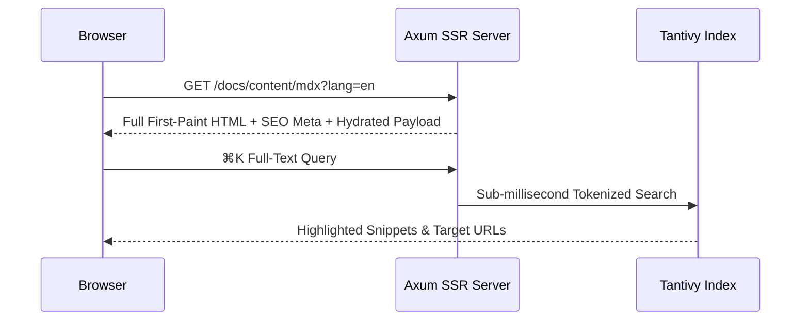

# Rich MDX Syntax & Interactive Components

On top of standard GitHub Flavored Markdown (tables, task lists, heading anchors, footnotes), DioxusPress ships purpose-built blocks and registered Rust components for technical writing.

## 1. Tabbed Code Blocks (`:::code-tabs`)

Wrap fenced code blocks labeled with `[Tab Title]` inside `:::code-tabs` to render an interactive switcher:

:::code-tabs
```bash [Zero-DB Dev Server]
cd crates/app
BASE_URL=http://127.0.0.1:8080 dx serve --web --no-default-features
```

```bash [Docker Build]
docker build --build-arg APP_FEATURES="--no-default-features" -t dioxuspress:basic .
```
:::

## 2. Semantic Admonitions

Seven built-in callout levels are supported: `:::tip`, `:::info`, `:::note`, `:::important`, `:::warning`, `:::caution`, and `:::error`:

:::tip
Admonitions support **bold text**, `inline code`, nested `:::code-tabs`, and Markdown links.
:::

## 3. Native Server-Rendered MathML

Inline math like Euler's identity $e^{i\pi} + 1 = 0$ and display equations compile on the server directly into browser-native semantic MathML — zero client-side font bundles or layout shift:

$$
\operatorname{Attention}(Q, K, V) = \operatorname{softmax}\!\left(\frac{QK^\top}{\sqrt{d_k}}\right)V
$$

## 4. Adaptive Mermaid Diagrams

Fenced `mermaid` blocks render flowcharts and sequence diagrams that adapt automatically to light and dark mode:



## 5. Built-In MDX Tags

Trusted content (`docs`, `blog`, `courses`) can invoke registered self-closing Rust components directly:

- **Inline callout highlights**: `<Blue text="Key concept" />`, `<Green text="Verified" />`, `<Yellow text="Heads up" />`, `<Pink text="Hot path" />`;
- **Interactive embeds**: `<ThemeShowcase />`, `<YouTube id="..." />`, `<Bilibili id="BV..." />`, `<PodcastCard id="..." />`.

:::note
User-generated content (forum posts, comments, paragraph notes) always passes through `widgets::parse_untrusted_markdown`, which strips raw HTML and event handlers and restricts images to controlled `/uploads/` paths.
:::
