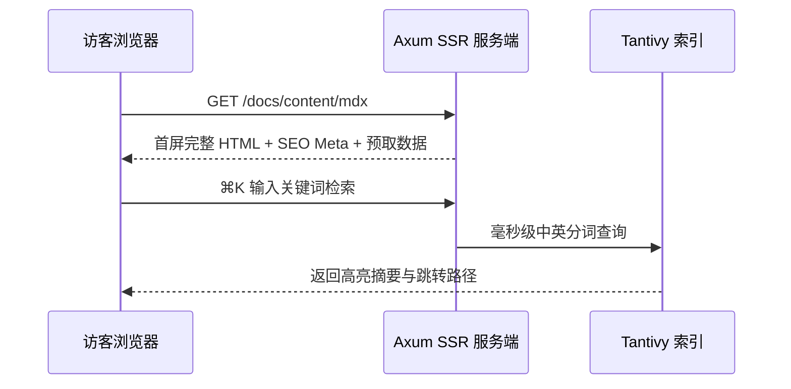

# MDX 富文本语法与交互组件

DioxusPress 在标准 GitHub Flavored Markdown（表格、任务列表、自动锚点、脚注）之上，提供了一整套专为工程技术写作打磨的扩展块与内嵌组件。

## 1. 多语言代码标签组（`:::code-tabs`）

在对比不同平台命令或多语言实现时，使用 `:::code-tabs` 包裹带 `[标签名]` 的代码块即可生成可切换标签栏：

:::code-tabs
```bash [零数据库模式]
cd crates/app
BASE_URL=http://127.0.0.1:8080 dx serve --web --no-default-features
```

```bash [Docker 构建]
docker build --build-arg APP_FEATURES="--no-default-features" -t dioxuspress:basic .
```
:::

## 2. 语义化提示框（Admonitions）

支持 `:::tip`、`:::info`、`:::note`、`:::important`、`:::warning`、`:::caution` 与 `:::error` 七种提示级别：

:::tip
提示框内部同样支持 **粗体**、`行内代码` 与超链接排版。
:::

## 3. 原生 MathML 数学公式

行内公式如欧拉恒等式 $e^{i\pi} + 1 = 0$，块级公式在服务端直接编译为浏览器原生支持的语义化 MathML，零客户端重型 JS 字体包阻塞：

$$
\operatorname{Attention}(Q, K, V) = \operatorname{softmax}\!\left(\frac{QK^\top}{\sqrt{d_k}}\right)V
$$

## 4. Mermaid 架构图与时序图

围栏代码块标记为 `mermaid` 即可自动渲染且随站点明暗模式自适应配色：



## 5. 内置 MDX 标签组件

在受信内容（文档、博客、课节正文）中可直接书写已注册的组件标签：

- **重点文字着色**：`<Blue text="蓝色强调" />`、`<Green text="通过状态" />`、`<Yellow text="关键提醒" />`、`<Pink text="性能热点" />`；
- **多媒体卡片**：`<YouTube id="..." />`、`<Bilibili id="BV..." />`、`<PodcastCard id="..." />`。

:::note
对于论坛帖子、评论与段落笔记等用户生成内容（UGC），渲染管线会自动切换为严格非受信模式：剥离一切原始 HTML 与事件属性，仅放行白名单协议与站内上传图片路径。
:::
