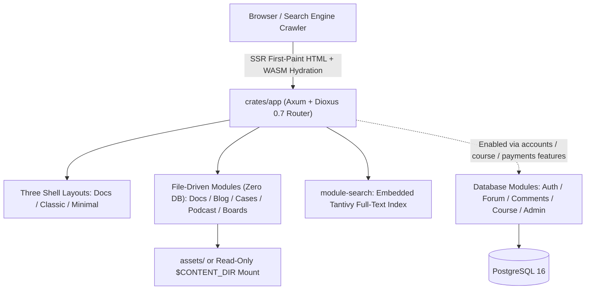

# Getting Started with DioxusPress

**DioxusPress** is a pure-Rust fullstack documentation, content, and community engine built on **Dioxus 0.7** and **Axum**. It runs as a **zero-database single binary (`basic` tier)** as a fast, low-memory alternative to Docusaurus, VitePress, or Starlight — and smoothly scales up with PostgreSQL and OAuth2 into an integrated knowledge portal with **blogs, structured courses, payments, community forums, inline paragraph annotations, and LLM-powered moderation**.

## Why DioxusPress?

- **True Fullstack Rust (SSR + WASM Hydration)**: Axum renders complete semantic HTML, Open Graph tags, and Schema.org JSON-LD on the first paint for instant search-engine indexing, while WebAssembly hydration takes over for sub-frame SPA navigation.
- **Turnkey Docusaurus-Grade Docs Experience**: Three-level sidebar trees, right-rail table of contents (TOC), hierarchical breadcrumbs, millisecond embedded Tantivy full-text search (`⌘K`), automatic volume-qualified `<title>` tags, and one-click "Edit this page on GitHub".
- **One Codebase, Four Feature Tiers**: Cargo features prune unused routes, UI, and database dependencies at compile time — from a zero-dependency static docs container to a full commercial community portal.
- **Configuration-Driven & Content-Decoupled**: Branding, shell layouts (`docs` / `classic` / `minimal`), dual-mode color themes (`ocean` / `sunset` / `catppuccin`), hero feature grids, and multi-column footers are all declared in a single `site.json`, supporting read-only mounted content repositories.

## Architecture Overview

## Volume Roadmap

1. **[5-Minute Quickstart](/docs/guide/quickstart)**: Launch a zero-compile Docker site in 50 seconds or run fullstack local development from source.
2. **[Feature Tiers (Cargo Features)](/docs/guide/feature-tiers)**: Compare `basic`, `accounts`, `course`, and full `payments` builds and runtime dependencies.
3. **[`site.json` Configuration Reference](/docs/guide/site-config)**: Customize branding, light/dark logos, announcement banners, hero CTAs, and module switches with JSON Schema autocomplete.
4. **[Layouts & Themes](/docs/guide/layouts-and-themes)**: Switch between `docs`, `classic`, and `minimal` shells and live-preview all 10 WCAG AA dual-mode themes.
5. **[Tailwind CSS v4 Workflow](/docs/guide/tailwind)**: Understand workspace-wide `@source` scanning and stylesheet builds.
6. **[Official Starter Templates](/docs/guide/templates)**: Compare the `docs`, `blog`, `community`, and `portal` presets (or browse the interactive [Templates Showcase](/templates)).
