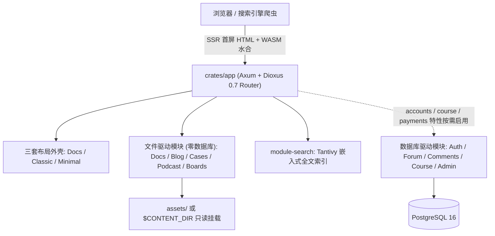

# DioxusPress 快速上手导览

**DioxusPress** 是基于 **Dioxus 0.7** 与 **Axum** 构建的纯 Rust 全栈内容、文档与社区引擎。它既能以**零数据库单二进制（`basic` 档位）**充当 Docusaurus / VitePress / Starlight 的高性能替代方案，也能按需开启 PostgreSQL 与 OAuth2，平滑演进为集成**博客、实战课程、在线支付、论坛社区、段落划线标注与 LLM 内容审核**的一体化知识平台。

## 为什么选择 DioxusPress？

- **纯正全栈 Rust（SSR + WASM 水合）**：首屏由 Axum 服务端直出完整语义化 HTML、Open Graph 与 JSON-LD 结构化数据，搜索引擎零门槛抓取；客户端 WebAssembly 水合后自动接管站内秒级无刷新跳转。
- **开箱即用的类 Docusaurus 文档体验**：内置三级目录树、右侧本页大纲（TOC）、层级面包屑、`⌘K` Tantivy 毫秒级中英全文检索、子章节 `<title>` 自动卷名限定以及「在 GitHub 上编辑此页」。
- **一库四档按需裁剪**：通过 Cargo Features 在编译期精确裁剪能力边界 —— 从零外部依赖的静态内容文档站，到带完整商业化闭环的社区门户，共用同一套代码库。
- **配置驱动与内容分离**：品牌标识、布局切换（`docs` / `classic` / `minimal`）、主题配色（`ocean` / `sunset` / `catppuccin`）、首页特性栅格与多列页脚全部由单个 `assets/site.json` 声明，支持外部私有内容目录只读挂载热更新。

## 架构全景

## 本卷路线图

1. **[5 分钟快速开始](/docs/guide/quickstart)**：本地克隆、启动零数据库文档站或完整全栈开发环境。
2. **[四档编译分层](/docs/guide/feature-tiers)**：对比 `basic`、`accounts`、`course` 与默认完整档位的依赖与体积差异。
3. **[`site.json` 全字段配置](/docs/guide/site-config)**：定制站名、明暗双态 Logo、公告横幅、首页 CTA 与模块开关。
4. **[布局与主题定制](/docs/guide/layouts-and-themes)**：切换类 Docusaurus 文档模板、门户模板与三套 shadcn 主题令牌。
5. **[Tailwind CSS v4 工作流](/docs/guide/tailwind)**：理解 `@source` 自动扫描机制与自定义组件样式构建。
