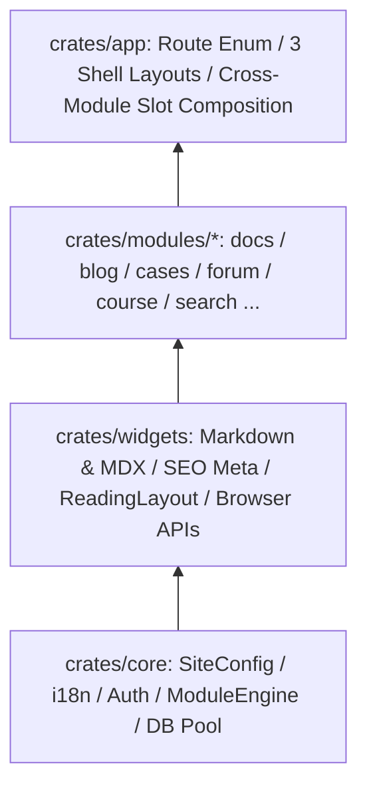

# Engine Architecture & Custom Module Development

DioxusPress avoids speculative plugin loaders and single-implementation trait factories. Every domain module is an ordinary **Rust crate** wired cleanly through explicit data contracts at the `crates/app` composition root.

## Layering & Dependency Rules

- **Zero Sibling Coupling**: Crates under `crates/modules/*` **never depend on one another**. For example, `module-docs` knows nothing about `module-forum` (discussions) or `module-course` (annotations); instead it accepts a `footer: Element` slot assembled by `crates/app` according to active Cargo features.

## Adding a Domain Module in Four Steps

1. **Create the Crate**: Under `crates/modules/<your-mod>/`, separate `#[cfg(feature = "server")]` data loaders from isomorphic Dioxus `#[component]` views.
2. **Register a `ModuleSpec`**: Add the module ID, route prefixes, and optional `static_path` to `builtin_module_specs()` in `crates/core/src/engines/module.rs` — wiring `site.json::modules.<id>.enabled` and `/sitemap.xml` automatically.
3. **Mount Routes Behind `ModuleGate`**: Add variants to `Route` in `crates/app/src/routes/mod.rs` wrapped in `ModuleGate { id: "<your-mod>", ... }` so runtime-disabled modules cleanly return `404`.
4. **(Optional) Index into Tantivy**: Add a collector in `crates/modules/search/src/indexer.rs` to surface entries inside the `⌘K` search dialog.
