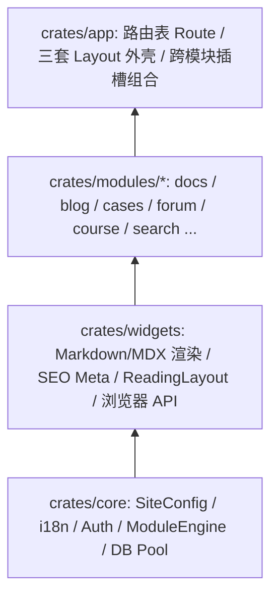

# 引擎架构与自定义模块开发

DioxusPress 拒绝过度设计（无空洞的运行时动态插件加载器或只有单一实现的复杂工厂抽象），所有业务模块都是工作区内的**标准 Rust Crate**，通过清晰的数据契约在 `crates/app` 组合根完成装配。

## 模块分层与依赖准则

- **横向零耦合硬约束**：`crates/modules/*` 下的兄弟业务模块之间**互不直接依赖**。例如 `module-docs` 完全不知道 `module-forum`（讨论面板）或 `module-course`（划线标注）的存在，而是暴露一个干净的 `footer: Element` 插槽，由顶层 `crates/app` 按编译特性组合注入。

## 四步新增一个业务模块

1. **新建独立 Crate**：在 `crates/modules/<your-mod>/` 下创建包，拆分 `#[cfg(feature = "server")]` 服务端读取逻辑与通用 Dioxus `#[component]` 视图组件。
2. **登记 `ModuleSpec`**：在 `crates/core/src/engines/module.rs` 的 `builtin_module_specs()` 中声明模块 ID、路由列表与静态入口路径 `static_path` —— 如此一来，`site.json::modules.<id>.enabled` 开关与 `/sitemap.xml` 收录即可自动生效。
3. **挂载路由与 `ModuleGate`**：在 `crates/app/src/routes/mod.rs` 的 `Route` 枚举中添加路由，并用 `ModuleGate { id: "<your-mod>", ... }` 包裹页面组件，确保运行时关闭模块时自动回退 404。
4. **（可选）接入全文搜索**：若该模块包含可检索文本，在 `crates/modules/search/src/indexer.rs` 中追加收集函数，即可立即出现在 `⌘K` 搜索模态框中。
